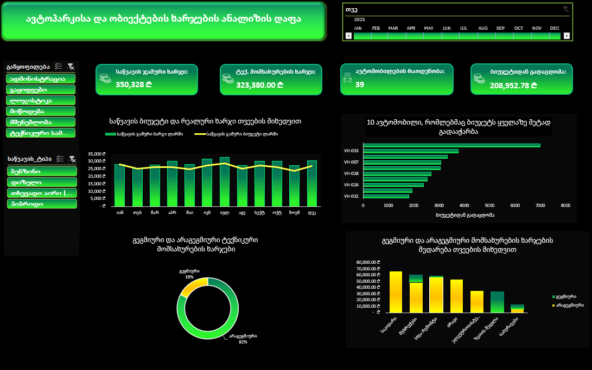
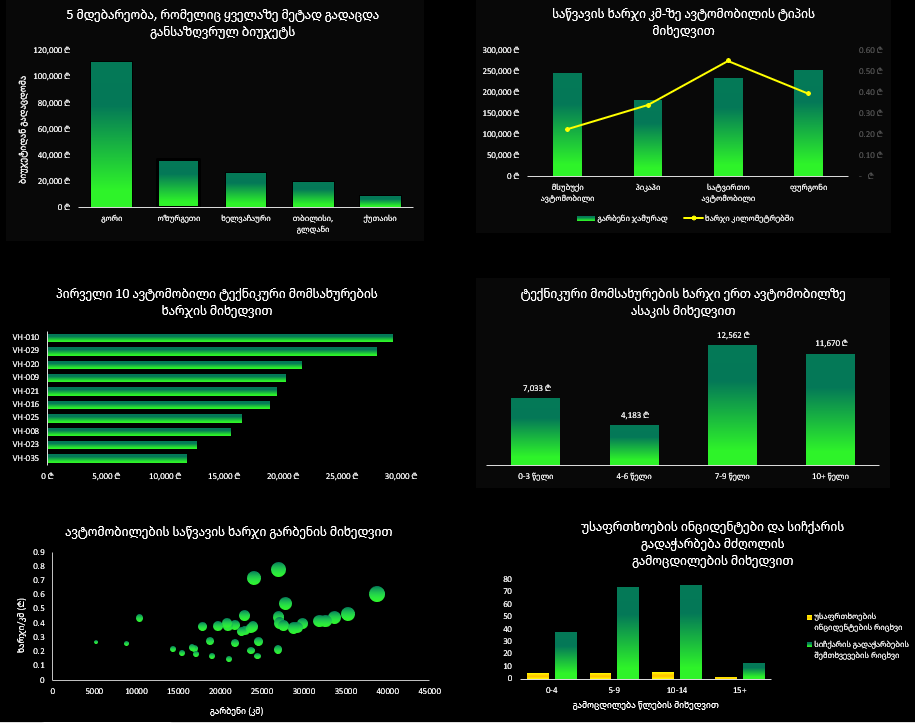
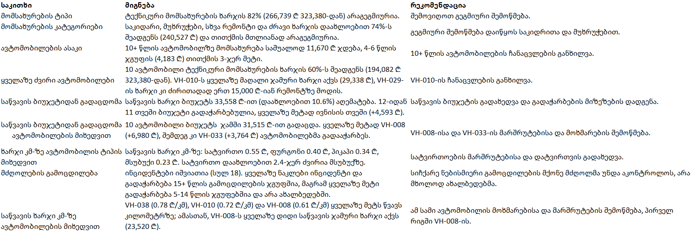

# ავტოპარკის ხარჯებისა და ეფექტიანობის ანალიზი

Excel-ის დეშბორდი ავტოპარკის ხარჯების ანალიზისთვის.

## ბიზნეს-შეკითხვა
რაში იხარჯება ავტოპარკის ბიუჯეტი ყველაზე მეტად (საწვავი, ტექნიკური მომსახურება, ობიექტები) და რა ზომები უნდა მიიღოს მენეჯმენტმა ხარჯების შესამცირებლად?

## დეშბორდი

## მთავარი მიგნებები და რეკომენდაციები

1. **არაგეგმიური რემონტი:** ტექნიკური მომსახურების ხარჯის 82% (266,739 ₾ 323,380-დან) არაგეგმიურია. რეკომენდაცია: გეგმიური შემოწმება საკიდრისა და მუხრუჭებისთვის.
2. **ძველი ავტომობილები:** 10+ წლის ავტომობილზე მომსახურება საშუალოდ 11,670 ₾ ჯდება, 4-6 წლის ჯგუფზე (4,183 ₾) თითქმის 3-ჯერ მეტი. რეკომენდაცია: ჩანაცვლების განხილვა, პირველ რიგში VH-010-ის შემთხვევაში.
3. **ობიექტების ბიუჯეტი:** ხარჯი ბიუჯეტს 208,953 ₾-ით (დაახლოებით 16%) აღემატება, აქედან გორზე 111,835 ₾ მოდის. რეკომენდაცია: გორის ხარჯების აუდიტი.

## გამოყენებული ინსტრუმენტები
Microsoft Excel: PivotTables, Data Model, DAX measures, PivotCharts, Power Query.

## ფაილები
- `ავტოპარკის ხარჯებისა და ეფექტიანობის ანალიზი.xlsx`: დეშბორდი, დასკვნები, გაწმენდილი ცხრილები
- `rawdata_ავტოპარკის ხარჯებისა და ეფექტიანობის ანალიზი.xlsx`: დაუმუშავებელი მონაცემები
